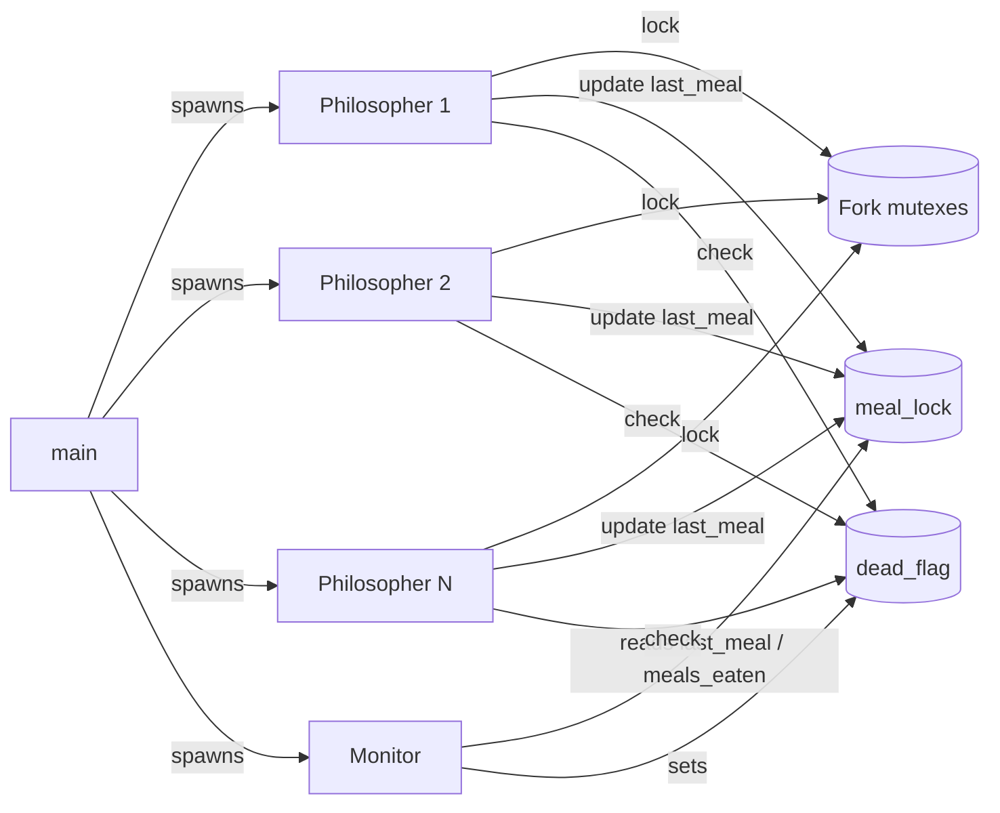

<div align="center">

# 🍝 Philosophers

**A multithreaded simulation of Dijkstra's Dining Philosophers problem in C, built with POSIX threads and mutexes.**


</div>

---

## 📑 Table of Contents

- [About](#-about)
- [The Problem](#-the-problem)
- [Features](#-features)
- [How It Works](#-how-it-works)
  - [Threads and Shared State](#threads-and-shared-state)
  - [Deadlock Prevention](#deadlock-prevention)
  - [Starvation Prevention](#starvation-prevention)
  - [Death Detection](#death-detection)
  - [Precise, Low-CPU Sleeping](#precise-low-cpu-sleeping)
- [Installation](#-installation)
- [Usage](#-usage)
- [Example Output](#-example-output)
- [Testing](#-testing)
- [Project Structure](#-project-structure)
- [Project Rules](#-project-rules)
- [Resources](#-resources)
- [Author](#-author)

---

## 📖 About

**Philosophers** solves a classic synchronization problem: it simulates the dining philosophers problem with process management and resource sharing. Threads and mutexes keep the simulation free of deadlocks and keep it efficient.

Each philosopher runs as its own thread and competes for shared forks, which are protected by mutexes. A monitor thread watches over everyone. The simulation has to meet these guarantees:

- no **deadlock**: the table never freezes,
- no **starvation**: no philosopher is locked out of the forks for good,
- no **data races**: all shared state is protected,
- **millisecond-accurate** timing, with each death reported within 10 ms.

The project is part of the [42 School](https://www.42network.org/) curriculum. It is an introduction to concurrent programming: thread lifecycles, mutual exclusion, race conditions and lock ordering.

---

## 🍽️ The Problem

Some philosophers sit around a round table with a large bowl of spaghetti in the middle. There is **one fork between each pair of neighbours**, so there are as many forks as philosophers.

```
              🧑 P1
         🍴          🍴
     🧑 P5     🍝     🧑 P2
         🍴          🍴
         🧑 P4  🍴  🧑 P3
```

- A philosopher needs **both** adjacent forks (left and right) to eat.
- Philosophers cycle through **eat → sleep → think**.
- If a philosopher goes `time_to_die` ms without *starting* a meal, they **die** and the simulation stops.
- Philosophers don't talk to each other and don't know when a neighbour is about to die.

The challenge is to build a schedule where nobody deadlocks (for example, everyone holding their left fork forever) and nobody starves. The only tools available are threads and mutexes.

---

## ✨ Features

- 🧵 **One thread per philosopher**, plus a dedicated monitor thread
- 🔒 **One mutex per fork**, plus mutexes guarding output, meal data and the stop flag
- 🚫 **Deadlock-free by construction**: forks are always locked in a global order (resource hierarchy)
- ⚖️ **Fair scheduling** for odd numbers of philosophers, so a hungry philosopher is never out-raced
- 🏁 **Synchronized start gate**: every thread's clock starts at the same instant, even with 200 threads
- ⏱️ **Accurate death reporting**, with no messages printed after a death
- 💤 **Low CPU usage**: the sleep loop wakes about log₂(ms) times per call instead of busy-waiting
- ✅ **Verified clean** with ThreadSanitizer, Valgrind Helgrind (no data races) and Memcheck (no leaks)
- 📏 Fully compliant with the 42 **Norm**

---

## ⚙️ How It Works

### Threads and Shared State



| Mutex        | Protects                                                              |
|--------------|-----------------------------------------------------------------------|
| `forks[i]`   | Fork *i*, shared by philosopher *i* and philosopher *i + 1*           |
| `write_lock` | `stdout`, so log lines never interleave. Also acts as the start gate. |
| `meal_lock`  | Every philosopher's `last_meal` and `meals_eaten`                     |
| `dead_lock`  | The shared `dead_flag` that tells every thread to stop               |

### Deadlock Prevention

The classic deadlock happens when every philosopher grabs their left fork at the same moment and then waits forever for the right one. That is a circular wait.

This implementation uses **resource hierarchy** ordering: each philosopher always locks the **lower-addressed fork first**. Because every thread acquires locks in the same global order, a cycle of waiting threads cannot form, so deadlock is impossible.

As an extra measure, even-numbered philosophers wait briefly at the start, which lets odd-numbered philosophers pick up their forks without contention.

### Starvation Prevention

Ordering prevents deadlock but **not starvation**. With an odd number of philosophers, a philosopher who just woke up can grab a fork a split second before a neighbour who is much hungrier.

The fix is a calculated thinking time. With *N* odd, at most *(N − 1) / 2* philosophers can eat at once, so each philosopher gets a turn every 3 meal slots. The thinking time is therefore:

```
think = 2 × time_to_eat − time_to_sleep        (only when N is odd, and only if > 0)
```

Each philosopher comes back to the table exactly when their turn comes around. This turns a free-for-all into a stable rotation.

### Death Detection

The monitor thread repeatedly checks every philosopher:

1. **Death:** `now − last_meal ≥ time_to_die`. The monitor takes `write_lock`, raises `dead_flag`, prints `died` and releases the lock. Setting the flag and printing happen *inside the same critical section*, so no other message can slip in after the death.
2. **Satiety** (optional 5th argument): once every philosopher has eaten `number_of_times_each_philosopher_must_eat` times, the monitor raises the stop flag.

Every philosopher checks the flag between actions and exits cleanly. `main` then joins all threads and destroys every mutex.

### Precise, Low-CPU Sleeping

`usleep` alone tends to oversleep, and a tight polling loop burns CPU. With 200 threads polling every 0.5 ms, the scheduler itself becomes the bottleneck. `ft_usleep` sleeps for **half the remaining time** on each step:

```
200 ms → sleep 100 → sleep 50 → sleep 25 → … → sleep 0.5 → done
```

It stays accurate to the millisecond and wakes up only about 10 times per call instead of about 400.

---

## 📦 Installation

### Prerequisites

- A C compiler (`cc`, `gcc` or `clang`)
- `make`
- A POSIX system with pthreads (Linux or macOS)

### Build

```bash
git clone https://github.com/rasiolisufaj/42-philosophers.git
cd 42-philosophers
make
```

| Command       | Description                                |
|---------------|--------------------------------------------|
| `make`        | Build the `philo` executable               |
| `make clean`  | Remove object files                        |
| `make fclean` | Remove object files and the executable     |
| `make re`     | Rebuild everything from scratch            |

---

## 🚀 Usage

```bash
./philo number_of_philosophers time_to_die time_to_eat time_to_sleep [number_of_times_each_philosopher_must_eat]
```

| Argument                                    | Description                                                                 |
|---------------------------------------------|-----------------------------------------------------------------------------|
| `number_of_philosophers`                    | Number of philosophers, which is also the number of forks (1–200)           |
| `time_to_die` (ms)                          | A philosopher dies if they don't start eating within this time of their last meal (or the start) |
| `time_to_eat` (ms)                          | Time spent eating, while holding both forks                                 |
| `time_to_sleep` (ms)                        | Time spent sleeping                                                         |
| `number_of_times_each_philosopher_must_eat` | *Optional.* The simulation stops once every philosopher has eaten this many times |

All arguments must be positive integers that fit in an `int`. Invalid input is rejected with an error message.

### Log Format

Every state change is printed as:

```
timestamp_in_ms philosopher_id action
```

where `action` is one of `has taken a fork`, `is eating`, `is sleeping`, `is thinking` or `died`.

---

## 🖥️ Example Output

**A philosopher dies.** Four philosophers can't keep up with `time_to_die = 310`:

```console
$ ./philo 4 310 200 100
0 1 has taken a fork
0 1 has taken a fork
0 1 is eating
0 3 has taken a fork
0 3 has taken a fork
0 3 is eating
200 3 is sleeping
200 1 is sleeping
200 4 has taken a fork
200 4 has taken a fork
200 4 is eating
200 2 has taken a fork
200 2 has taken a fork
200 2 is eating
300 1 is thinking
300 3 is thinking
310 1 died
```

**A lone philosopher.** There is only one fork, so they can never eat:

```console
$ ./philo 1 800 200 200
0 1 has taken a fork
800 1 died
```

**Nobody dies.** This run continues forever, or until every philosopher has eaten N times:

```console
$ ./philo 5 800 200 200 7
```

---

## 🧪 Testing

### Standard Evaluation Cases

| Command                       | Expected result                                 |
|-------------------------------|-------------------------------------------------|
| `./philo 1 800 200 200`       | Philosopher 1 dies at 800 ms                    |
| `./philo 5 800 200 200`       | Nobody dies                                     |
| `./philo 5 800 200 200 7`     | Stops once everyone has eaten 7 times           |
| `./philo 4 410 200 200`       | Nobody dies                                     |
| `./philo 4 310 200 100`       | A philosopher dies at 310 ms                    |
| `./philo 2 100 200 100`       | A philosopher dies at 100 ms                    |
| `./philo 5 610 200 200`       | Nobody dies (tight: 10 ms margin)               |
| `./philo 3 610 200 100`       | Nobody dies                                     |
| `./philo 200 410 200 200`     | Nobody dies (stress test: 10 ms margin)         |

### Checking for Data Races and Leaks

```bash
# Data races: ThreadSanitizer
cc -g -fsanitize=thread -pthread -Iincludes srcs/*.c -o philo_tsan
./philo_tsan 5 800 200 200 3

# Data races: Valgrind Helgrind
valgrind --tool=helgrind ./philo 5 800 200 200 3

# Memory leaks
valgrind --leak-check=full ./philo 5 800 200 200 3
```

All three report **0 errors**.

> [!NOTE]
> **Running on WSL2?** WSL2 periodically re-syncs its virtual machine's wall clock, so `gettimeofday()` can jump forward by about 1 second. Any philosopher whose margin is smaller than the jump will "die". This is an environment issue, not a simulation bug, and the 42 subject only allows `gettimeofday()` for timekeeping. For tight cases such as `5 610 200 200` or `200 410 200 200`, test on native Linux or macOS.

---

## 📁 Project Structure

```
.
├── Makefile
├── includes/
│   └── philo.h        # Structs (t_philo, t_program) and prototypes
└── srcs/
    ├── main.c         # Argument check, allocation, simulation lifecycle
    ├── init.c         # Argument validation; program, fork and philosopher setup
    ├── threads.c      # Start gate, thread creation/joining, philosopher routine
    ├── actions.c      # eat / sleep / think, fork ordering, lone-philosopher case
    ├── monitor.c      # Death and meal-count watcher, thread-safe logging
    └── utils.c        # ft_atoi, timing helpers, cleanup
```

---

## 📜 Project Rules

This project follows the constraints of the 42 subject:

- Written in **C** and compliant with the **42 Norm** (functions ≤ 25 lines, ≤ 5 functions per file, …)
- No global variables
- Allowed functions only: `memset`, `printf`, `malloc`, `free`, `write`, `usleep`, `gettimeofday`, `pthread_create`, `pthread_detach`, `pthread_join`, `pthread_mutex_init`, `pthread_mutex_destroy`, `pthread_mutex_lock`, `pthread_mutex_unlock`
- Must not crash, leak memory or contain data races
- A death must be printed within **10 ms** of when it actually happens

---

## 📚 Resources

- [Dining philosophers problem (Wikipedia)](https://en.wikipedia.org/wiki/Dining_philosophers_problem)
- [E. W. Dijkstra: *Hierarchical Ordering of Sequential Processes* (EWD310)](https://www.cs.utexas.edu/~EWD/transcriptions/EWD03xx/EWD310.html)
- [POSIX Threads Programming (LLNL)](https://hpc-tutorials.llnl.gov/posix/)
- [`pthread_mutex_lock(3)` man page](https://man7.org/linux/man-pages/man3/pthread_mutex_lock.3p.html)

---

## 👤 Author

**Rasiol Isufaj** (`raisufaj` at 42)

[](https://github.com/rasiolisufaj)

<div align="center">

⭐ If this project helped you understand concurrency, consider giving it a star!

</div>
